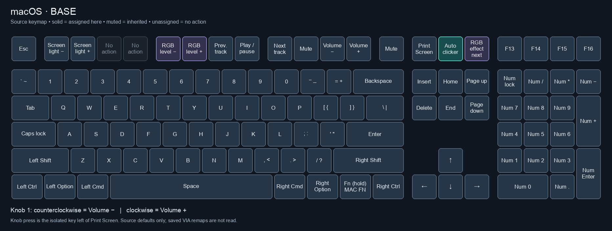
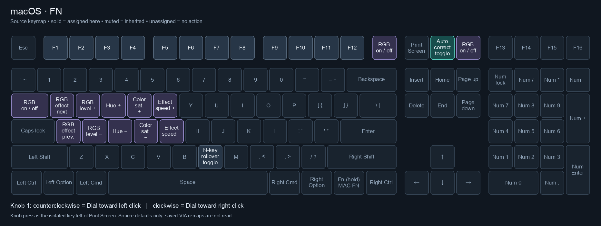
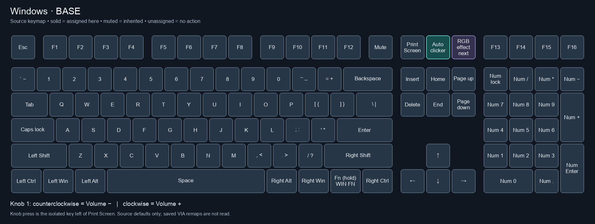
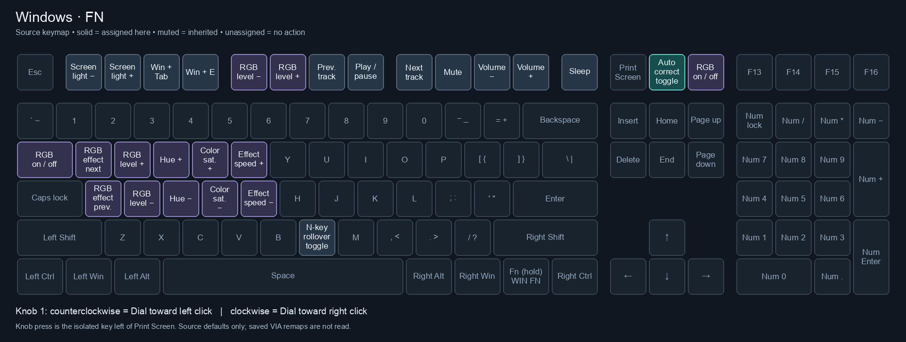

# V6 layer viewer






[View all layers in one image](output/all_layers.png)

These images are tracked in Git at fixed paths. Regenerate them after changing
key bindings, then include the updated PNGs in your commit. The image links here
stay the same; no README edits are needed.

Generate PNG diagrams directly from the current `bregmi/keymap.c`, using physical
key positions/sizes from the V6 ANSI encoder `keyboard.json`. Nothing is flashed
or changed in the firmware. Saved VIA remaps are not read.

From the QMK repository root:

```sh
python3 -m venv tools/layer_viewer/.venv
tools/layer_viewer/.venv/bin/pip install -r tools/layer_viewer/requirements.txt
tools/layer_viewer/.venv/bin/python tools/layer_viewer/render_layers.py
```

Open `tools/layer_viewer/output/all_layers.png`, or the individual `mac_base.png`,
`mac_fn.png`, `win_base.png`, and `win_fn.png`. `layers.json` records source keycodes
and resolved labels for inspection.

To regenerate automatically as you edit the keymap:

```sh
tools/layer_viewer/.venv/bin/python tools/layer_viewer/render_layers.py --watch
```

Stop with Ctrl+C. Reopen/reload an image if your image viewer caches it.

## Interpretation

- Each Fn layer is shown over its corresponding Mac or Windows base. Transparent
  keys inherit that base and are muted. Unassigned keys perform no action.
- Teal highlights autoclicker/autocorrect; purple highlights RGB controls.
- Encoder rotation is listed below each diagram; its press is drawn in the layout.
- Object-like aliases such as `KC_TASK` are read from the keymap and displayed as
  their shortcut. Unknown macros are shown literally, rather than guessed.

This is a small source viewer for the current keymap, not a C compiler. It supports
named `LAYOUT*` initializers, nested macro arguments, and `ENCODER_CCW_CW` mappings.
It does not evaluate conditional compilation, included C definitions, or arbitrary
runtime/multi-layer combinations beyond the OS base/Fn pairs. Duplicate conditional layer definitions are
rejected. Built-in action labels describe default keycode behavior, not arbitrary
custom callbacks. Use `--keymap`, `--keyboard`, and `--output` to override paths.
